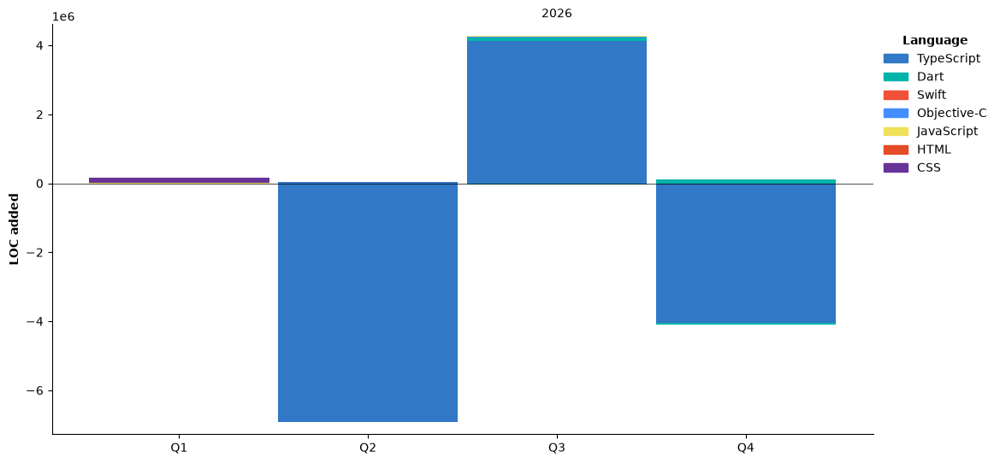

**Frontend & Flutter Developer** building modern web and mobile apps.

## Tech Stack


## Coding Activity

<!--START_SECTION:waka-->


**I'm an Early 🐤** 

```text
🌞 Morning                67 commits          ███░░░░░░░░░░░░░░░░░░░░░░   12.81 % 
🌆 Daytime                335 commits         ████████████████░░░░░░░░░   64.05 % 
🌃 Evening                114 commits         █████░░░░░░░░░░░░░░░░░░░░   21.80 % 
🌙 Night                  7 commits           ░░░░░░░░░░░░░░░░░░░░░░░░░   01.34 % 
```
📅 **I'm Most Productive on Monday** 

```text
Monday                   111 commits         █████░░░░░░░░░░░░░░░░░░░░   21.22 % 
Tuesday                  73 commits          ███░░░░░░░░░░░░░░░░░░░░░░   13.96 % 
Wednesday                64 commits          ███░░░░░░░░░░░░░░░░░░░░░░   12.24 % 
Thursday                 63 commits          ███░░░░░░░░░░░░░░░░░░░░░░   12.05 % 
Friday                   69 commits          ███░░░░░░░░░░░░░░░░░░░░░░   13.19 % 
Saturday                 81 commits          ████░░░░░░░░░░░░░░░░░░░░░   15.49 % 
Sunday                   62 commits          ███░░░░░░░░░░░░░░░░░░░░░░   11.85 % 
```


📊 **This Week I Spent My Time On** 

```text
🕑︎ Time Zone: Asia/Bishkek

💬 Programming Languages: 
Dart                     5 hrs 23 mins       ████████████████████░░░░░   79.14 % 
Swift                    52 mins             ███░░░░░░░░░░░░░░░░░░░░░░   12.91 % 
JSON                     17 mins             █░░░░░░░░░░░░░░░░░░░░░░░░   04.32 % 
CocoaPods                10 mins             █░░░░░░░░░░░░░░░░░░░░░░░░   02.48 % 
Git Config               2 mins              ░░░░░░░░░░░░░░░░░░░░░░░░░   00.69 % 

🔥 Editors: 
VS Code                  6 hrs 48 mins       █████████████████████████   100.00 % 

🐱‍💻 Projects: 
mirtaxi_core_flutter     2 hrs 8 mins        ████████░░░░░░░░░░░░░░░░░   31.45 % 
clean_architecture_flutte1 hr 8 mins         ████░░░░░░░░░░░░░░░░░░░░░   16.76 % 
pils_flutter             56 mins             ███░░░░░░░░░░░░░░░░░░░░░░   13.84 % 
swift-learning           52 mins             ███░░░░░░░░░░░░░░░░░░░░░░   12.95 % 
7kazan_flutter           26 mins             ██░░░░░░░░░░░░░░░░░░░░░░░   06.44 % 

💻 Operating System: 
Mac                      6 hrs 48 mins       █████████████████████████   100.00 % 
```

🤖 **AI Coding This Week** 

```text
⏱ AI Coding Time: 53 mins (13.19%)

✍️ 75 lines written by AI, 259 lines written by hand (22.46% AI-written)

🔤 151,825 Input Tokens, 31,481 Output Tokens

💵 $0.07 Estimated AI Cost This Week

🧠 2 AI Sessions, 20 AI Prompts

GPT                      75 lines            █████████████████████████   100.00 % 

🔎 AI Coding Insights:
🧑‍💻 Mostly Hands-On — 22.46% of written lines came from AI
📝 Concise Prompter — average 455 characters per prompt
🔁 Iterative Prompter — average 10 prompts per session
🔍 Hands-On Reviewer — 84.41% of changed lines were hand-edited
```

**I Mostly Code in Dart** 

```text
Dart                     25 repos            ███████████░░░░░░░░░░░░░░   42.37 % 
TypeScript               13 repos            ██████░░░░░░░░░░░░░░░░░░░   22.03 % 
JavaScript               11 repos            █████░░░░░░░░░░░░░░░░░░░░   18.64 % 
Swift                    3 repos             █░░░░░░░░░░░░░░░░░░░░░░░░   05.08 % 
Python                   1 repo              ░░░░░░░░░░░░░░░░░░░░░░░░░   01.69 % 
```


**Timeline**




 Last Updated on 09/11/2026 12:27:49 UTC
<!--END_SECTION:waka-->
